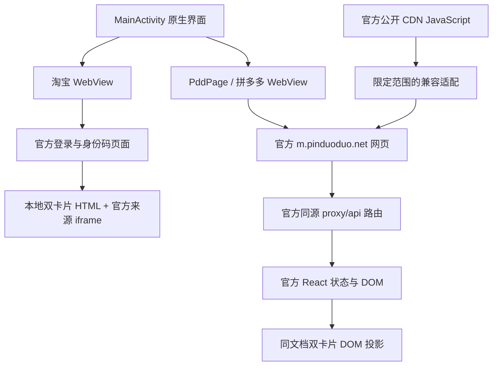

# HandyCode

<p align="center"></p>

将淘宝和拼多多的**官方身份码、待取包裹**集中到一个 Android 应用中。每个平台采用上下双卡片、整页滚动，保留官方登录与数据更新流程。

HandyCode merges the official pickup-code and pending-parcel pages of Taobao and Pinduoduo into a single Android app. It is an unofficial project and is not affiliated with Alibaba or Pinduoduo.

当前版本：**0.7.7**，Android 8.0（API 26）及以上，目标 API 35。

- [下载 APK](https://github.com/xianhe51920/handycode/releases)
- [版本、包大小及签名证书摘要](release.json)

安装包随 GitHub Releases 分发，仓库不跟踪构建产物。下载站是独立项目，不随本仓库发布。

## 免责声明

本项目为非官方客户端，与淘宝、拼多多及其所属公司无任何关联，也未获其授权或认可。

应用只在本机系统 WebView 中加载各平台官方页面，不自建账号服务、不代理业务接口、不采集或保存账号密码、验证码、Cookie 与码值。使用前请自行确认是否符合你所在地区的法律及各平台服务条款；因使用本应用产生的账号风险、风控或数据问题由使用者自行承担。

## 使用方式

1. 进入淘宝或拼多多，首次使用时在官方网页完成登录及必要验证。
2. 身份码在上、待取包裹在下。条码使用官方实时内容，不需要分别滚动两个网页窗口。
3. 点击底部标签，或在内容区横向拖动切换平台。超过半屏或短距离快速滑动可完成切换。
4. 每张卡片独立刷新；另一个分区继续显示。未登录时右上角显示“未登录”，登录后显示“退出登录”，仅作用于当前平台。
5. 拼多多登录页的“打开拼多多APP”可直接打开官方 App 的身份码页；系统未能处理时保留官方网页备用入口。
6. 应用会记住上次停留的平台，重新打开时直接回到该平台；从桌面快捷方式进入时，以快捷方式指定的平台为准。

## 隐私与登录

**首次使用需要登录。** 应用内直接打开淘宝与拼多多的官方网页，登录、短信验证码、滑块验证都在这些官方页面里完成，凭据由系统 WebView 与平台服务器直接处理，应用不介入登录过程。

**应用不获取个人信息：**

- 只申请网络权限（`android.permission.INTERNET`），不申请存储、位置、通讯录、相机、短信、电话等权限
- 不读取、不保存、不上传账号、密码、验证码与登录令牌
- 不读取 Cookie 内容，也不在原生层代发携带登录态的业务请求；原生层只按白名单下载拼多多官方公开的页面脚本做兼容适配（见下文「拼多多」章节），不带 Cookie 或令牌。登录状态由系统 WebView 自身的 Cookie 存储维护，应用只在退出登录时按站点清除
- 没有自建服务器、统计 SDK 或崩溃上报服务，不接入任何埋点
- 登录状态只以「已登录 / 未登录」的布尔值显示在界面上，不作为凭据使用
- 身份码与待取包裹来自官方页面，只在本应用界面内展示，不写入文件、不导出、不上传
- 本地只保存一项界面偏好：上次停留的平台（`taobao` 或 `pinduoduo` 两个固定值），不含账号、手机号或任何码值
- 退出登录时只清除当前平台在 WebView 中按站点保存的 Cookie 与本地存储，不动其他站点

卸载应用或清除应用数据后，需要在官方页面重新登录。

## 整体结构

原生 Java 负责页面容器、手势、动画、登录状态提示和 WebView 生命周期；HTML / JavaScript 负责将官方页面内容投影成统一布局。项目没有自建账号服务器或业务 API 服务。



图中的同源代理是**拼多多已有的官方路由**，不由 HandyCode 提供；登录、验证码和业务请求仍在系统 WebView 中执行。

## 淘宝实现原理

- `MainActivity` 先加载固定官方身份码入口。`official-identity.js` 检查实际码内容、登录输入控件及跨域认证 iframe；只有官方页面已能显示有效内容，才切入合并布局，避免用空壳覆盖登录页。
- `taobao.html` 在一个文档中展示身份码、待取包裹。官方来源 iframe 保留在后台，读取可访问的来源 DOM，并复制展示节点；卡片里的必要操作转发给原官方元素。
- `refresh-controller.js` 将主动刷新和来源 iframe 的被动 `load` / DOM 更新分开。主动刷新只让对应卡片进入加载状态，重复点击合并；相同可见内容保留节点、更新事件引用，避免“刷新 / 刷新中”与骨架反复闪烁。
- 原始身份码未生成时，仅在非登录状态下有界触发官方刷新控件；输入手机号、验证码或显示认证 iframe 时暂停，不自行提交表单。
- `taobao-login-chrome.js` 只隐藏“您需要登录才能继续访问 / 关闭”这一外层标题，回收 iframe 顶部占位。官方 iframe 的节点和 `src` 不变，输入与验证流程继续由官方处理。

## 拼多多：网页跳转与登录问题如何解决

完整细节见 [拼多多 H5 实现说明](docs/pdd-html-investigation.md)。

### 1. 为什么原链接登录后又回登录页

入口是 `https://m.pinduoduo.net/mdkd/package?tab=ID_CODE`。排查时发现：身份码页的浏览器业务请求发往 `https://api.pinduoduo.com/api/...`，而普通网页登录使用当前官方站点已有的 `/proxy/api/` 路由。

`.net` 页面与 `.com` API 属于跨站访问，Cookie 的作用域、SameSite 及浏览器跨站规则都会影响会话是否被服务端接受。曾观察到页面短暂显示框架、前置检查报告未登录，随后回到登录页。单独一条 `api_uid` 的 SameSite 警告不能证明它就是登录凭据，也不能说明所有跳转都由它造成。

### 2. 保留官方逻辑，将请求接回官方同源路由

`PddPage` 只拦截严格匹配的官方公开 CDN `_app-<hash>.js`，正常 HTTPS 下载后，在前面加入兼容脚本。`pdd-same-origin.js` 在原应用脚本执行前包装 `XMLHttpRequest.open` 和 `fetch`，只映射指定来源：

```text
https://api.pinduoduo.com/api/express_trackbox/...
                         ↓
https://m.pinduoduo.net/proxy/api/api/express_trackbox/...
```

这里的 **`/proxy/api/api/` 两段 `api` 是有意保留的**：官方代理前缀为 `/proxy/api`，原 API 路径仍以 `/api/` 开头。

脚本保留原方法、请求体、请求头、查询参数与调用选项；`Request` 输入按原对象重建。认证仍由 WebView 按官方站点规则管理。应用不读取或搬运 Cookie / Token，不在原生层代发业务请求，也不修改 SameSite、证书验证或伪装官方客户端。登录页和验证页不应用这段 API 映射。

### 3. 控制跳转，而不是无限重登

- WebView 内部只允许 `https://m.pinduoduo.net` 的正常 HTTPS 导航，阻止其他域名和任意协议接管页面。
- 官方登录验证偶尔会落到 `/index.html`，丢失身份码返回目标。应用在确实经过登录后，**最多自动返回身份码入口一次**；仍失败则保留官方页面，避免强制重定向循环。
- 登录页“打开拼多多APP”是另一条手动路径：仅在当前官方登录页、主框架、有用户手势且目标精确匹配时，由原生显式交给 `com.xunmeng.pinduoduo`：

  ```text
  pinduoduo://com.xunmeng.pinduoduo/mdkd/package?tab=ID_CODE
  ```

  这条路径调用原来已验证的身份码深链，安装有拼多多时直接交给该 App。它与 H5 登录保持相互独立，不会把 App 的登录凭据复制到 WebView。未加入微信网页入口。

### 4. 为什么登录状态能保留

- 启用 WebView 的 Cookie 和 DOM Storage，复用同一应用的默认 WebView 数据目录，不在启动、切页、退出 Activity 或覆盖更新时清空它。
- 页面完成和应用进入后台时执行 `CookieManager.flush()`，让 Cookie 存储及时落盘；`localStorage` 等仍由浏览器按来源管理。拼多多不依赖放开第三方 Cookie，而使用上述第一方官方代理。
- 两个平台首次打开后保留各自 WebView 与当前文档。切页只是移动、裁剪视图，停止非当前页的原生骨架高光；应用进入后台才暂停 WebView，回来后恢复。
- Release 沿用相同包名与签名，使用 `adb install -r` 覆盖安装，继续使用原沙箱数据。

`flush()` 不会延长官方 Cookie 的过期时间，也不会把会话 Cookie 变成永久凭据。卸载、清除应用数据、主动退出、服务端会话失效或风控要求重新验证时，仍需要登录；电脑浏览器和官方 App 的会话也不会自动同步给本应用。

## 拼多多：双卡片、独立刷新与加载恢复

### 同一文档投影，保持官方 React 活着

`pdd-layout.js` 保留原始 `#__next` 根节点，将它移到屏幕外；另外创建 `#hc-pdd-shell` 展示身份码与待取包裹。不会搬走 React 原节点，也不另造一个带独立滚动条的可见 iframe。

身份码复用官方生成的图片或 SVG，仅撤销展示布局中的旋转，使其横向、居中；不会解码或重新生成条码。待取区只投影当前待取列表或空状态，隐藏推荐商品、已取记录和原始底栏。需要绑定手机号等表单时，临时显示原官方流程并提供返回入口。

### 每张卡片只刷新自己

`PddBundleAdapter` 对两个固定公开组件脚本（`1235-<hash>.js`、`8905-<hash>.js`）进行唯一锚点匹配，在组件生命周期内注册其现成的身份码与包裹查询回调。响应处理只报告成功布尔值，不把业务数据交给原生层。

`pdd-section-refresh.js` 按分区去重，允许两个分区并行，12 秒超时；`pdd-layout.js` 固定所点卡片高度、隐藏旧显示、等待官方状态更新后替换这一块，另一块 DOM 不变。失败只在当前卡片显示重试。上游脚本结构不匹配时不勉强替换、不误绑回调，也不退回整页刷新。

### 避免原页闪现和永久骨架

- 原生 `PddLoadingView` 先遮住未整理的原页；合并壳及源标记存在后，读取少量几何数字，并等待 `postVisualStateCallback` 确认绘制，再淡出。
- 脚本执行早于 `#__next` 挂载时，等待根节点出现；即使超过提示时间，也允许晚到节点继续初始化。
- 除提交回调外，文档完成回调也能启动交接；遮罩期间每 500ms 检查就绪，最多 60 次。已准备好但缺少新 console 阶段时仍可恢复。不会因此自动重载网页或重复业务请求。
- 内容默认不透明，短暂入场效果在隐藏时取消。已访问页保持附着，避免返回时只剩有标题的空白卡片。

## 原生交互与退出登录

`SwitchMotion` 用一个 0—1 进度同时驱动中间页面横移、顶部图标标题纵向切换和底部选中背景移动。松手时按半屏距离判断；速度达到 600dp/s 且移动至少 24dp 时支持短距离快滑。`SwipeFrameLayout` 区分横向意图和竖向滚动，取消时回到已选平台；未访问页预览只有静态骨架，落定后才创建并加载 WebView。

键盘只缩减网页可用区域，底栏保持物理位置。登录状态提示使用固定阶段 / 布尔值；这只是界面状态，不作为认证凭据。

退出时关闭当前平台旧网页，再用 AndroidX WebKit 的按站点删除能力清理其 Cookie、JS 存储和缓存，完成后打开登录入口。淘宝范围为项目允许的五个登录站点，拼多多为 `pinduoduo.net`。不会调用全局 Cookie / WebStorage 清理来退出单个平台。WebView 不支持该能力时提示更新。

## 构建 Release

需要 JDK 17+、Android SDK Platform 35、Build Tools 36.0.0、Node.js 24+。不依赖 Gradle：`aapt2 → javac → D8 → zipalign → apksigner`。

```powershell
npm ci --ignore-scripts
.\build-android.ps1 -Configuration Release -AndroidSdk 'D:\path\to\SDK' -JavaHome 'D:\path\to\JDK'
```

默认即为 Release；`-Configuration Debug` 可单独生成开发产物。Release 显式 `android:debuggable="false"`，WebView 调试也始终关闭。产物同步到根目录与 `dist/`，并生成 SHA256 与 `release.json`。

**签名延续原调试期证书**，用于兼容已有安装；本机密钥仍位于 `.local/debug.keystore`，不进入 Git 或 APK。Release 构建在缺少该密钥时会停止，避免悄悄生成另一把密钥。应用商店发布需另行规划生产签名与迁移。

AndroidX WebKit 精简库随仓库提供并在构建前校验 SHA256；其来源、Apache 许可和离线重建方式见 [依赖说明](third_party/androidx-webkit-1.13.0/README.md)。

## 应用图标

图标为方案 2「圆角底板版」：奶油色圆角底板、深红描边、角色抱快递箱。源图 `design/icon-candidates/icon-02.png`，候选与生成提示词见 [design/icon-candidates](design/icon-candidates/PROMPTS.md)。

采用 Android 自适应图标：`mipmap-anydpi-v26/ic_launcher.xml` 组合背景色 `#FCF6E7` 与前景位图，前景用 `<inset>` 内缩 13%。这个比例是按「底板描边正好落在 72dp 可见视口边缘」算出来的，使深红描边贴住图标边界；背景与底板同色，遮罩裁切不会露出接缝。

一套资源即可适配所有密度与桌面图标尺寸，不需要多套 `mipmap-*dpi`。但遮罩形状由桌面决定，红框只能对齐圆角方形遮罩，圆形遮罩桌面上四角描边会被裁掉一部分。换算方式、重新生成步骤和验收记录见 [应用图标原理](docs/launcher-icon.md)。

## 检查与已知边界

构建会运行导航域名限制、同源映射、组件适配、独立刷新、登录保护、DOM 投影、加载恢复、切换及退出隔离等回归，再检查 DEX、对齐、签名与包信息。真机安装与无线调试见 [无线调试说明](docs/wireless-debugging.md)，逐版本验证记录见 [内嵌网页版本验证记录](docs/webview-validation.md)。

已在真机验证官方真实身份码显示、双卡片布局、分区刷新、切换保留及遗漏就绪回调恢复。退出隔离测试只使用虚构站点，不代替真实账号退出 / 重登验收；有实际待取件时的全部详情、长时间保活和码过期更新仍需实际场景验证。

曾出现拼多多偶发长时间加载、随后自行恢复；已修复可复现的晚挂载缺口并补充遮罩恢复，但当时完整状态未捕获，不能保证排除所有网络或上游变更因素。H5 和公开脚本结构受平台更新影响，适配不匹配时会停止对应操作并提示重试。

应用只申请网络权限，不实现拍照 / 文件上传验证。不在独立文件或日志中保存账号、验证码、Cookie、接口响应或码值；网页登录数据由系统 WebView 持有，应用禁用系统备份。

## 主要文件

| 文件 | 职责 |
| --- | --- |
| `MainActivity.java` | 原生容器、淘宝集成、标题与底栏、键盘和生命周期 |
| `PddPage.java` | 拼多多 WebView、公开脚本适配、登录返回及绘制交接 |
| `UrlPolicy.java` | 官方 HTTPS 导航、公开脚本及固定深链范围 |
| `SwitchMotion.java` / `SwipeFrameLayout.java` | 联动进度、拖动识别与落定规则 |
| `SiteDataClearer.java` / `LogoutSites.java` | 当前平台按站点退出 |
| `assets/taobao.html` | 淘宝双来源投影与卡片布局 |
| `assets/pdd-same-origin.js` | 官方同源 API 路由映射 |
| `assets/pdd-layout.js` | 拼多多投影、表单返回及加载恢复 |
| `PddBundleAdapter.java` / `assets/pdd-section-refresh.js` | 官方组件回调与独立刷新协调 |

Java 文件均位于 `app/src/main/java/com/fairycrane/handycode/`，网页资源位于 `app/src/main/assets/`。

## 许可

源码以 [MIT 许可](LICENSE) 发布。随仓库提供的 AndroidX WebKit 精简库为 Apache License 2.0，来源与许可文本见 [third_party/androidx-webkit-1.13.0](third_party/androidx-webkit-1.13.0/README.md)。

应用图标由作者提供的参考图生成，仅作本项目标识使用；若其中涉及第三方角色形象，其权利归原权利人，MIT 许可不涵盖该图形。
